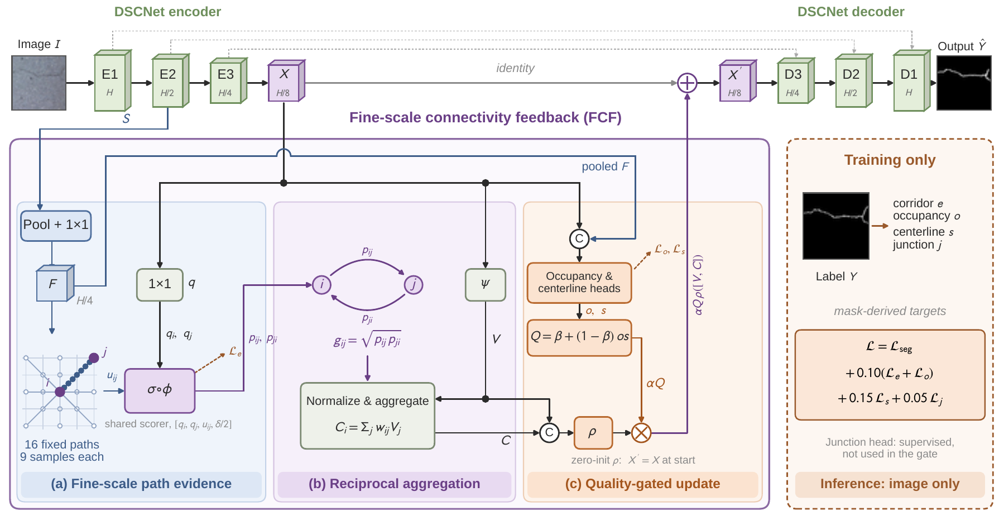

# Fine-Scale Connectivity Feedback for Curvilinear Segmentation

本项目提供论文 **Curvilinear Structure Segmentation with Fine-Scale Connectivity Feedback** 中方法的核心代码。模型将 Fine-Scale Connectivity Feedback（FCF）模块接入 DSCNet，在裂缝、道路、血管等细长结构的二分类分割中，利用细尺度路径证据辅助瓶颈特征聚合。

论文中的 **Ours** 对应代码入口 `create_model('dscnet_fc_v2', seed=2027)`；`fine_curve_v2` 是本项目的实验标识，并不是 DSCNet 官方的 v2 版本。

## 论文简介

裂缝、道路和血管通常具有细长、弯曲或分叉的形状。图像中低对比度、背景纹理和局部断裂会使这类结构难以准确分割。DSCNet 的动态蛇形卷积可以沿结构调整采样位置，但邻近特征之间是否存在连续的前景证据，仍需要进一步判断。

本文在 DSCNet 的编码器与解码器之间引入 FCF：利用浅层细尺度特征检查邻近位置之间的路径，再依据双向连接预测聚合特征，并通过占据和中心线估计控制反馈强度。结构监督由训练标注生成；推理时模型只接收图像。

## 网络架构



*整体框架：上方为 DSCNet 编码器—解码器；下方依次展示细尺度路径证据、双向连接聚合和质量门控更新。右侧结构监督仅用于训练。原始矢量图见 [Fig1_optimized.pdf](assets/Fig1_optimized.pdf)。*

图中各部分对应以下计算过程：

1. DSCNet 编码器生成浅层特征和瓶颈特征。FCF 将浅层特征投影到较细的证据图。
2. 对每个瓶颈位置，在八个方向、两个网格半径上构造 16 条**固定候选路径**，每条路径采样 9 个点，并结合端点特征预测连接分数。
3. 结合两个方向的连接分数，生成相互一致的邻域权重，聚合附近特征。
4. 占据和中心线预测共同控制残差更新。训练时结合分割损失以及路径、占据、中心线和交叉点辅助监督；交叉点预测不参与质量门控。

FCF 的路径是固定直线路径，DSCNet 主干的蛇形采样才是可变形采样。FCF 在推理时只使用图像，不使用标注，也不保证预测结果全局连通。

## 论文中的主要结果

下表摘自论文核心比较：所有数值为 80 轮训练、三次运行的逐图平均 IoU（%）的均值 ± 样本标准差。Ours 指 DSCNet 与 FCF 的完整组合。

| 数据集 | DSCNet | Ours |
| --- | ---: | ---: |
| CFD | 57.592 ± 0.798 | 58.300 ± 0.302 |
| Crack500 | 55.435 ± 0.709 | 55.932 ± 0.449 |
| DeepCrack | 72.800 ± 1.710 | 73.139 ± 1.494 |
| DRIVE（内部划分） | 66.362 ± 0.192 | 66.968 ± 0.172 |
| MASS Roads | 64.100 ± 0.254 | 64.451 ± 0.263 |

这项比较反映特征反馈与结构监督的联合效果，不能单独归因于其中某一个组件。DRIVE 使用内部留出划分；这些测试集在先前探索中曾被反复使用。更多指标、对比方法及实验限制请参见论文及补充材料。

## 文件说明

```text
.
├── models.py                         # DSCNet 接入 FCF、模型与损失入口
├── example_smoke_test.py             # 随机输入的前向和反向运行检查
├── assets/                           # 论文架构图（GitHub 展示版与原始 PDF）
├── requirements.txt
├── source_hashes.json                # 归档核心源码 SHA-256
├── snapshot/backend/cracklab/
│   ├── modules/verified_v3.py        # FCF 主体；选择 fine_curve_v2 分支
│   ├── modules/verified.py           # 边界平移等共享函数
│   ├── modules/common.py             # 共享张量操作
│   ├── objective_v2.py               # 分割和结构监督损失
│   ├── corridor_targets.py           # 从训练标注构造结构目标
│   ├── losses.py                     # BCE、Dice 和共享损失
│   └── metrics.py                    # 原训练代码所用骨架化函数
└── vendor/dscnet_source/             # 实验使用的 DSCNet 主干及其 MIT 许可
```

为保持与归档实验一致，这些核心文件原样保留。共享源码中可能包含其他历史分支；本文方法只使用 `dscnet_fc_v2` / `fine_curve_v2` 分支。`metrics.py` 是目标构造使用的归档训练实现，不是论文完整测试评估器。

## 安装

需要 Python 3.10 或更高版本。建议新建虚拟环境，并先按照 [PyTorch 安装说明](https://pytorch.org/get-started/locally/)安装适合本机 CPU 或 CUDA 的 PyTorch，再安装其他依赖：

```bash
python -m pip install -r requirements.txt
python example_smoke_test.py
```

示例会打印输出形状、损失项以及 `Forward and backward: OK`。它使用随机生成的 32×32 输入，仅检查代码执行，不代表分割精度或训练结果。

本包已在 CPU 环境下使用 Python 3.11.15、PyTorch 2.12.1、NumPy 2.4.6、SciPy 1.17.1 和 einops 0.8.1 完成该检查；这些是验证环境，不是论文实验环境的完整锁定清单。

## 最小使用示例

```python
import torch
from models import create_model, Objective

model = create_model('dscnet_fc_v2', seed=2027)
image = torch.randn(1, 3, 64, 64)       # NCHW，RGB，浮点数
mask = torch.zeros(1, 1, 64, 64)        # N1HW，二值训练标签

logits, aux = model(image, return_aux=True)
loss, terms = Objective('dscnet_fc_v2')(logits, aux, mask)
loss.backward()

model.eval()
with torch.no_grad():
    logits = model(image)
    probability = torch.sigmoid(logits)
    prediction = probability >= 0.5
```

示例创建的是**随机初始化模型**。实际推理需要自己加载与本架构匹配的训练权重，并按训练时的方式预处理图片。输出是单通道原始 logits，阈值应根据任务和验证协议确定。为了与网络下采样和训练目标对齐，示例使用长宽为 8 的倍数的图像。

实际训练时需提供自己的数据读取、数据增强、优化器和训练循环。本包仅含方法主代码及运行所需依赖，**不包含**完整实验管线、数据集划分、训练配置、预训练权重或测试脚本，因此不能仅凭此包直接复现论文数值。论文中的实验使用 512 像素输入和指定数据划分、验证集选模及评价协议；实际部署需根据任务处理边界和大图切块。

## 来源与许可

FCF 和接入代码来自论文实验的归档快照；文件校验值见 `source_hashes.json`。DSCNet 主干来自 [YaoleiQi/DSCNet](https://github.com/YaoleiQi/DSCNet)，上游提交为 `0e35b2b6ea748a5e8ce7557ea3e580b9951471d6`。主干文件保留于 `vendor/dscnet_source/`，其 MIT 许可见该目录的 `LICENSE`。

本包尚未为项目原创代码指定开源许可；公开发布前请由著作权人决定许可，并核对论文、代码、数据与权重的发布权限。引用本文时请补充最终发表的论文信息。
